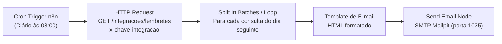

# FEAT-01: Lembrete Automático de Consultas com n8n (24h Antes)

## 1. Visão Geral e Justificativa

- **Prioridade no Ranking**: 1º Lugar (RICE Score: 20.0)
- **Status**: Selecionada para Implementação (Bônus Oficial de Engenharia)
- **Objetivo**: Reduzir drasticamente o absenteísmo (*no-show*) notificando automaticamente os pacientes 24 horas antes do horário de suas consultas agendadas.

O esquecimento é o principal fator de absenteísmo na atenção básica e especializada. Disparar uma mensagem estruturada com data, hora, profissional e localidade 24h antes permite que o paciente se programe com antecedência ou avise caso não possa comparecer.

---

## 2. Arquitetura da Solução

O fluxo de automação opera de forma desacoplada da API principal utilizando o motor de orquestração **n8n**:



### 2.1. Componentes e Comunicação
1. **Container n8n (`localhost:5678`)**:
   - Acionado via agendamento cron diário (ex.: todo dia às 08:00 da manhã).
   - Comunica-se com a API da clínica via `http://host.docker.internal:3333`.
2. **Endpoint Seguro da API (`GET /integracoes/lembretes`)**:
   - Autenticado via header `x-chave-integracao: CHAVE_INTEGRACAO` (definido em `apps/api/.env`).
   - Retorna as consultas ativas (`status = 'agendada'`) do dia seguinte:
     ```json
     [
       {
         "id": "c1",
         "data": "2026-10-17",
         "hora": "09:00",
         "pacienteNome": "Maria Silva",
         "pacienteEmail": "maria@exemplo.com",
         "profissionalNome": "Dr. Roberto",
         "especialidade": "Clínica geral"
       }
     ]
     ```
3. **Servidor SMTP Mailpit (`localhost:1025` / UI `localhost:8025`)**:
   - Recebe as mensagens enviadas pelo n8n sem necessidade de credenciais ou TLS.
   - Interface web para inspeção dos e-mails disparados.

---

## 3. Especificação do Fluxo n8n (`n8n/lembrete.json`)

1. **Schedule Trigger**: Executa todos os dias às 08:00 no fuso `America/Recife`.
2. **HTTP Request Node**:
   - Método: `GET`
   - URL: `http://host.docker.internal:3333/integracoes/lembretes`
   - Headers: `x-chave-integracao: {{ $env.CHAVE_INTEGRACAO || 'chave-secreta-para-testes' }}`
3. **Code / Template Node**:
   - Constrói o corpo do e-mail com layout da Clínica Bem Viver:
     - Assunto: `Lembrete: Sua consulta na Clínica Bem Viver amanhã às {{ $json.hora }}`
     - Corpo HTML: Nome do paciente, data formatada, horário, profissional, especialidade e instruções para comparecimento com 15 minutos de antecedência.
4. **Send Email Node**:
   - Host: `mailpit`
   - Porta: `1025`
   - From: `atendimento@clinicabemviver.com.br`
   - To: `{{ $json.pacienteEmail }}`

---

## 4. Evolução para Produção

- **Canais adicionais**: Suporte a envio via WhatsApp Business API (Twilio / Z-API) e SMS.
- **Idempotência**: Gravação de timestamp `lembreteEnviadoEm` no modelo `Consulta` para evitar reenvio acidental em caso de retry do workflow.
